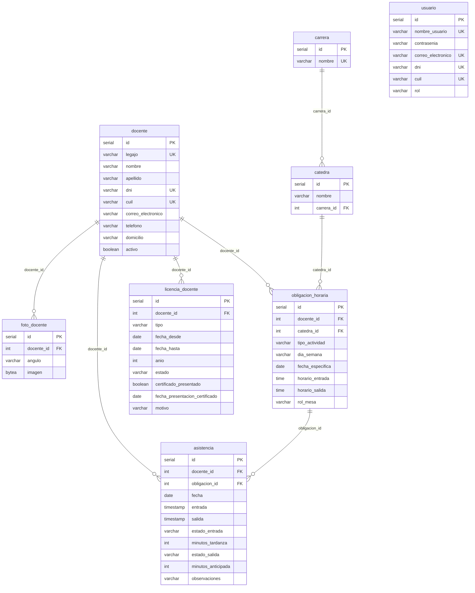

# Registro de Evolución del Proyecto - Asistencia Profesores
## Contexto A: IES N.º 7 Populorum Progressio

---

## 📌 Paso 1: Rediseño del DER e Inicialización de la Base de Datos

### 1. Objetivo del Paso 1
Transformar el modelo de datos original del Sistema de Asistencia Facial (diseñado para alumnos) en un modelo relacional educativo adaptado a las obligaciones horarias y normativas de los docentes del **IES N.º 7 Populorum Progressio**, garantizando un aislamiento total a nivel de infraestructura Docker y control de versiones Git.

---

### 2. Aislamiento de Infraestructura
* **Rama Git:** `feature/asistencia-profesores` (independiente de `main`).
* **Stack Docker (`compose.yaml`):**
  * Contenedor: `asistencia_profesores_db`
  * Base de datos: `sistema_profesores`
  * Puerto externo: `5440:5432` *(sin colisión con el puerto 5439 de la app original)*
  * Volumen persistente: `pgdata_profesores_v1`
* **Variables de entorno (`.env` / `.env.example`):**
  * `POSTGRES_PORT=5440`
  * `POSTGRES_DB=sistema_profesores`

---

### 3. Modelo Relacional Definitivo (DER)

Se crearon las 8 tablas oficiales en PostgreSQL utilizando tipos de datos estándar y restricciones de integridad:

---

### 4. Reglas del Dominio Soportadas

1. **Clases de 1h 20m (80 minutos):**
   * Gestionadas en `obligacion_horaria` mediante `horario_entrada` y `horario_salida`.
2. **Clases consecutivas y múltiples cátedras:**
   * Un docente puede tener múltiples registros en `obligacion_horaria` para un mismo día sin superposición.
3. **Eventos Especiales (Jornadas Institucionales y Mesas de Examen):**
   * Las Mesas de Examen guardan `fecha_especifica`, `catedra_id` y `rol_mesa` (`presidente`, `vocal`, `auxiliar`).
   * Las Jornadas Institucionales no requieren cátedra obligatoria (`catedra_id` es `NULL`).
4. **Tardanzas y Salidas Anticipadas:**
   * La tabla `asistencia` clasifica la entrada como `en_horario` o `tardanza` (si excede 5 minutos de tolerancia), almacenando los `minutos_tardanza`.
   * Registra `salida` (nullable para identificar salidas sin registrar) y su estado (`normal`, `anticipada`, `sin_salida`).
5. **Régimen de Inasistencias (`licencia_docente`):**
   * **Días Particulares:** Control estricto de cupo de hasta 6 por año por docente mediante el campo `anio`.
   * **Licencias Médicas:** Ciclo de estados `pendiente` ➔ `confirmada` al presentar el certificado correspondiente (`certificado_presentado = TRUE` y fecha de entrega).

---

### 5. Estado de Verificación
* Contenedor Docker: `asistencia_profesores_db` en ejecución en puerto `5440`.
* Script DDL: `database/initdb/01-schema.sql` ejecutado y validado en PostgreSQL (8 tablas creadas, fixtures iniciales de carreras y cátedras cargados).
* Script de limpieza `reset_db.py` adaptado al nuevo esquema.
