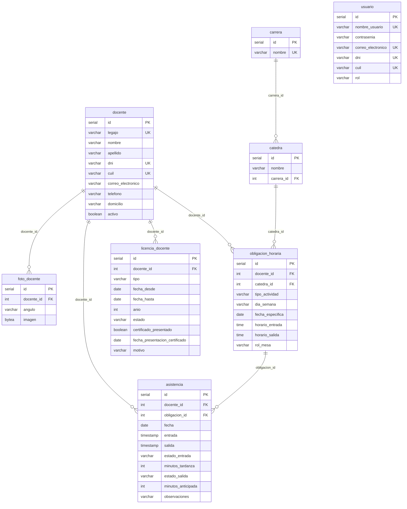

# Registro de Evolución del Proyecto - Asistencia Profesores
## Contexto A: IES N.º 7 Populorum Progressio

---

## 📌 Paso 1: Rediseño del DER e Inicialización de la Base de Datos

### 1. Objetivo del Paso 1
Transformar el modelo de datos original del Sistema de Asistencia Facial (diseñado para alumnos) en un modelo relacional educativo adaptado a las obligaciones horarias y normativas de los docentes del **IES N.º 7 Populorum Progressio**, garantizando un aislamiento total a nivel de infraestructura Docker y control de versiones Git.

---

### 2. Aislamiento de Infraestructura
* **Rama Git:** `feature/asistencia-profesores` (independiente de `main`).
* **Stack Docker (`compose.yaml`):**
  * Contenedor: `asistencia_profesores_db`
  * Base de datos: `sistema_profesores`
  * Puerto externo: `5440:5432` *(sin colisión con el puerto 5439 de la app original)*
  * Volumen persistente: `pgdata_profesores_v1`
* **Variables de entorno (`.env` / `.env.example`):**
  * `POSTGRES_PORT=5440`
  * `POSTGRES_DB=sistema_profesores`

---

### 3. Modelo Relacional Definitivo (DER)

Se crearon las 8 tablas oficiales en PostgreSQL utilizando tipos de datos estándar y restricciones de integridad:

---

### 4. Reglas del Dominio Soportadas

1. **Clases de 1h 20m (80 minutos):**
   * Gestionadas en `obligacion_horaria` mediante `horario_entrada` y `horario_salida`.
2. **Clases consecutivas y múltiples cátedras:**
   * Un docente puede tener múltiples registros en `obligacion_horaria` para un mismo día sin superposición.
3. **Eventos Especiales (Jornadas Institucionales y Mesas de Examen):**
   * Las Mesas de Examen guardan `fecha_especifica`, `catedra_id` y `rol_mesa` (`presidente`, `vocal`, `auxiliar`).
   * Las Jornadas Institucionales no requieren cátedra obligatoria (`catedra_id` es `NULL`).
4. **Tardanzas y Salidas Anticipadas:**
   * La tabla `asistencia` clasifica la entrada como `en_horario` o `tardanza` (si excede 5 minutos de tolerancia), almacenando los `minutos_tardanza`.
   * Registra `salida` (nullable para identificar salidas sin registrar) y su estado (`normal`, `anticipada`, `sin_salida`).
5. **Régimen de Inasistencias (`licencia_docente`):**
   * **Días Particulares:** Control estricto de cupo de hasta 6 por año por docente mediante el campo `anio`.
   * **Licencias Médicas:** Ciclo de estados `pendiente` ➔ `confirmada` al presentar el certificado correspondiente (`certificado_presentado = TRUE` y fecha de entrega).

---

## 📌 Paso 2: Capa de Repositorios y Servicios de Negocio

### 1. Objetivo del Paso 2
Implementar la arquitectura de software desacoplada (Patrón Repositorio y Capa de Servicios) con estándares industriales, garantizando tipado estricto, manejo transaccional seguro y resolución automática de todas las reglas de negocio del IES N.º 7 Populorum Progressio.

---

### 2. Módulos Desarrollados

#### A. `src/repositories/docente_repository.py`
* **Alta y gestión integral de docentes:** Operaciones sobre `docente` con validación y sanitización de DNI, CUIL, Legajo y datos de contacto.
* **Persistencia Biométrica:** Métodos `guardar_foto()` y `obtener_todas_las_fotos()` compatibles con el motor DeepFace/OpenCV para los 3 ángulos (`frontal`, `izquierdo`, `derecho`).
* **Búsquedas indexadas:** Búsqueda rápida por DNI, CUIL o Legajo para mesa de entrada y preceptoría.

#### B. `src/repositories/horario_repository.py`
* **Estructura Académica:** Consultas y asignación de Carreras y Cátedras.
* **Planificación Horaria:** Registro de clases de 80 minutos, Mesas de Examen (con rol de Presidente, Vocal o Auxiliar) y Jornadas Institucionales.
* **Resolución Temporal Inteligente (`obtener_obligacion_actual`):**
  * Prioriza eventos de fecha puntual (Mesas/Jornadas) sobre clases habituales.
  * Valida ventanas de tolerancia de marcación previa y posterior.
  * Resuelve clases consecutivas en el mismo día seleccionando la que corresponda al horario de llegada.

#### C. `src/repositories/asistencia_repository.py`
* **Entrada Segura:** Registro de `entrada` con auditoría de `minutos_tardanza` y estado `en_horario` o `tardanza`.
* **Salida Controlada:** Actualización de `salida` con auditoría de `minutos_anticipada` y estado `normal` o `anticipada`.
* **Prevención de Duplicados:** `obtener_asistencia_del_dia()` para evitar dobles marcaciones innecesarias.

#### D. `src/repositories/licencia_repository.py`
* **Control de Particulares:** Método `contar_particulares_consumidos()` y `cupo_particular_disponible()` para asegurar el límite reglamentario de hasta 6 anuales.
* **Ciclo de Licencias Médicas:** Registro inicial en estado `pendiente` y promoción a `confirmada` mediante `confirmar_certificado_medico()` al asentar la entrega formal del certificado.
* **Detección de Licencias Activas:** Intercepta intentos de marcación si el docente está de licencia justificada.

#### E. `src/services/asistencia_service.py` (Cerebro del Dominio)
* **`evaluar_marcacion(docente_id, momento)`:**
  * No persiste cambios: analiza el estado del docente y su obligación horaria actual.
  * Determina si corresponde **ENTRADA** o **SALIDA**.
  * Aplica los 5 minutos de tolerancia para clasificar `tardanza` vs `en_horario`.
  * Detecta salidas antes del horario previsto como `anticipada`.
  * Genera el payload de datos y texto explicativo listo para el diálogo modal obligatorio.
  * Maneja casos especiales: docente inactivo, con licencia activa, sin actividad programada o marcación ya completada.
* **`confirmar_marcacion(evaluacion)`:**
  * Se invoca **exclusivamente cuando el usuario presiona [OK]** en el modal de confirmación.
  * Si el usuario presiona [Cancelar], la operación se descarta y la base de datos no sufre modificaciones.

#### F. `src/repositories/informe_repository.py`
* **Planilla Analítica de Asistencias:** Cruce de cada marcación contra el horario y cátedra esperados, calculando automáticamente demoras y anomalías.
* **Planilla de Licencias y Particulares:** Balance de cupos utilizados (sobre 6) y estado de certificados médicos.
* **Resumen Ejecutivo por Docente:** Indicadores agregados para la toma de decisiones administrativas.

---

### 3. Validación Industrial Automatizada (`tests/test_paso2.py`)
Se ejecutó la suite de pruebas contra PostgreSQL en Docker, superando el 100% de los casos:
1. `DocenteRepository`: Creación y consulta exitosa.
2. `HorarioRepository`: Vinculación de cátedras y creación de clase de 80 minutos.
3. `AsistenciaService (Entrada en horario)`: Verificación de tolerancia (3 min de diferencia = en horario).
4. `AsistenciaService (Entrada con tardanza)`: Detección correcta de 9 min de demora.
5. `AsistenciaService (Confirmación)`: Persistencia controlada post-modal.
6. `AsistenciaService (Salida anticipada)`: Detección correcta de 15 min de salida antes de hora.
7. `AsistenciaService (Salida normal)`: Cierre de jornada en horario reglamentario.
8. `Caso Especial (Marcación duplicada)`: Bloqueo de re-intento tras completar entrada y salida.
9. `LicenciaRepository (Particulares)`: Cupo inicial de 6, descuento a 5 tras uso.
10. `LicenciaRepository (Médica)`: Transición `pendiente` -> `confirmada` al registrar certificado.
11. `InformeRepository`: Generación de planillas y cálculo de resúmenes ejecutivos.

---

## 📌 Paso 3: Motor de Reconocimiento y Diálogo Modal Obligatorio

### 1. Objetivo del Paso 3
Dar estricto cumplimiento a los **requisitos comunes y del flujo de marcación** estipulados en las **Secciones 4, 5.1 y 5.3** de la consigna oficial:
* Ninguna marcación se persiste inmediatamente tras la identificación.
* Se presenta un diálogo modal obligatorio (`ConfirmacionMarcacionDialog`) con el docente reconocido, la cátedra u obligación horaria y la acción propuesta (ENTRADA / SALIDA).
* Si el docente presiona **OK**, se efectiviza el INSERT o UPDATE en PostgreSQL.
* Si el docente presiona **Cancelar** (o cierra el modal), la operación se descarta completamente sin alterar la base de datos.
* Mientras el modal está visible, **la webcam continúa transmitiendo en vivo a 30 FPS**, pero el sistema **pausa temporalmente nuevos reconocimientos** para evitar solicitudes superpuestas. Al cerrarse el diálogo (por OK o Cancelar), el reconocimiento se reanuda con un enfriamiento preventivo (*cooldown*).

---

### 2. Módulos Desarrollados y Adaptados

#### A. `src/ui/confirmacion_marcacion_dialog.py` (Nuevo Diálogo Modal)
* **Clase `ConfirmacionMarcacionDialog(QDialog)`:**
  * Modal estricto (`setModal(True)`) con diseño institucional adaptado al IES N.º 7 Populorum Progressio.
  * Badges interactivos según la operación:
    * `ENTRADA`: Verde (*En Horario*) o Naranja (*Tardanza con minutos de demora*).
    * `SALIDA`: Azul (*Normal*) o Ámbar (*Salida Anticipada con minutos de anticipación*).
  * Ficha descriptiva: Docente, Legajo, Actividad/Cátedra, Carrera, Horario previsto y Rol en mesa (si aplica).
  * Botones de acción ergonómicos:
    * **`[ OK (Confirmar Registro) ]`**: `accept()` ➔ autoriza la persistencia.
    * **`[ Cancelar ]`**: `reject()` ➔ descarta la operación.

#### B. `src/ai/reconocimiento_thread.py`
* Migrado para consumir fotos vectorizadas de la tabla `foto_docente` mediante `DocenteRepository`.
* Métodos thread-safe de control: `pausar()` y `reanudar()`.
* Si el hilo está en estado pausado (modal visible), ignora los crops entrantes y emite `finished_processing` de inmediato sin generar eventos de match.

#### C. `src/ui/camera_thread.py`
* Mantiene el streaming continuo a 30 FPS con el óvalo biométrico y retícula cardinal interactiva.
* Incorpora `pausar_reconocimiento()` y `reanudar_reconocimiento(cooldown_segundos)`.
* Al abrirse el modal, el video de la cámara no se congela (cumplimiento reglamentario estricto), pero no se envían nuevos rostros a inferencia.

#### D. `src/ui/asistencia_widget.py`
* Desacoplado de la antigua configuración manual de "jornada": ahora la app consulta automáticamente la grilla y la hora actual.
* Integración fluida con `AsistenciaService`:
  * Si el docente no tiene actividad: notificación visual y de voz ("Sin actividad programada en este horario").
  * Si la asistencia ya está completa: bloqueo preventivo ("Asistencia ya completada para hoy").
  * Si la marcación es viable: dispara el modal, captura la decisión del usuario (OK/Cancelar) y reanuda el ciclo de la cámara.

#### E. `requirements.txt`
* Incorporación de la dependencia `tf-keras` requerida por DeepFace para compatibilidad con TensorFlow / Keras en la nueva versión.

---

### 3. Validación Automatizada Superada (`tests/test_paso3.py`)
Se ejecutó la suite de verificación automatizada del Paso 3, superando el 100% de las pruebas:
1. `ReconocimientoThread`: Comportamiento de `pausar()` y `reanudar()` verificado.
2. `CameraThread`: Pausa de detección sin interrumpir el stream de video a 30 FPS y reanudación con *cooldown*.
3. `ConfirmacionMarcacionDialog`: Instanciación y renderizado en modo Entrada con tardanza (botones OK / Cancelar activos y modal estricto).
4. `ConfirmacionMarcacionDialog`: Instanciación y renderizado en modo Salida anticipada.
